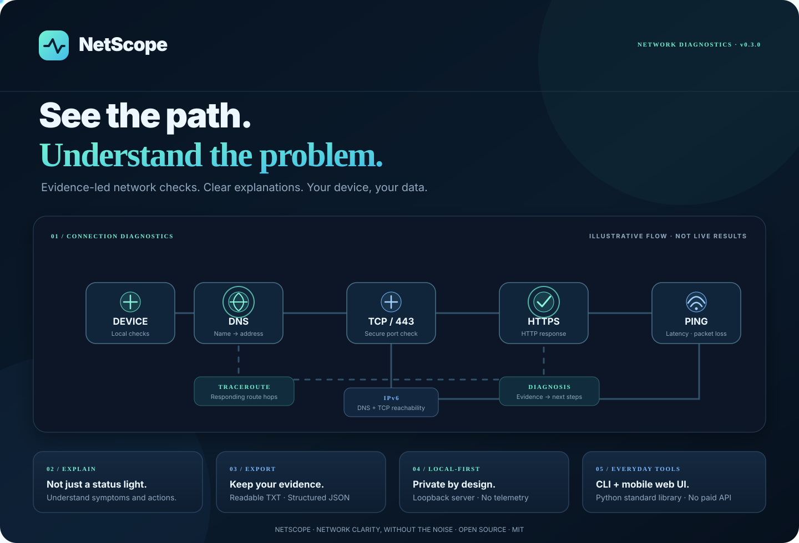

<div align="center">



# NetScope

### See the path. Understand the problem.

**Privacy-first network diagnostics for Android, Linux, macOS and Windows**

[](LICENSE)
[](https://www.python.org/)
[](#technology)
[](#privacy-by-design)

**[Quick start](#quick-start) · [Features](#capabilities) · [Web interface](#mobile-friendly-web-interface) · [Security](SECURITY.md) · [Testing](TESTING.md)**

</div>

---

## The problem, made understandable

A connection can fail at several different layers. DNS may resolve while TCP is blocked. TCP may connect while HTTPS fails. Ping may time out even though the website is healthy.

NetScope checks these signals separately, organizes the evidence, and explains what the results suggest — with practical next steps instead of an unexplained green or red light.

**NetScope is a diagnostic toolkit, not an offensive security scanner.** It is designed for troubleshooting your own device, services, and networks you are authorized to examine.

## Product capabilities

| Capability | What NetScope does |
|---|---|
| **Smart diagnosis** | Checks DNS, TCP port 443, HTTPS response and optional ping; classifies common symptoms and suggests next steps. |
| **DNS lookup** | Resolves hostnames and returns the available IP addresses. |
| **TCP connectivity** | Tests whether a selected host and port accept a TCP connection. |
| **Ping** | Reports ICMP reachability and parses packet-loss and latency statistics when the system ping utility is available. |
| **IPv6 diagnostics** | Separates IPv6 DNS record availability from actual TCP/443 connectivity. |
| **Traceroute** | Displays responding route hops when the optional system utility is installed. |
| **Reports** | Prints results and saves JSON or readable TXT reports locally. |
| **Mobile web UI** | Runs a responsive browser interface on the same device through a loopback-only local server. |
| **Multilingual experience** | Tajik, Russian and English interface and smart diagnosis explanations. |

## How the diagnosis works

<ol>
<li><strong>DNS resolution</strong> — can the hostname be resolved to an address?</li>
<li><strong>TCP port 443</strong> — can the device establish a secure-port connection?</li>
<li><strong>HTTPS request</strong> — does the destination return an HTTP response?</li>
<li><strong>Ping</strong> — does ICMP respond, and what latency or packet loss is reported?</li>
<li><strong>Interpretation</strong> — combine the evidence into a bounded diagnosis and suggested next steps.</li>
</ol>

A failed ping is **not** treated as proof that the internet is down. Firewalls, carriers and destination servers can block ICMP while DNS, TCP and HTTPS continue to work.

## Quick start

### Requirements

- Python 3.10 or newer.
- Git.
- No third-party Python packages are required for the core toolkit.

### Android — Termux

```bash
pkg update
pkg install python git
git clone https://github.com/Khayom1/NetScope.git
cd NetScope
python -m netscope.cli diagnose example.com
```

### Linux, macOS and Windows

```bash
git clone https://github.com/Khayom1/NetScope.git
cd NetScope
python -m netscope.cli diagnose example.com
```

Some diagnostic commands depend on operating-system utilities. In particular, ping and traceroute availability and command-line behavior can differ by platform.

## Mobile-friendly web interface

Start the local web interface:

```bash
python -m netscope.web
```

Open **http://127.0.0.1:8765** in a browser on the same device.

The web server binds to loopback only. It is not a public website and is not exposed as a LAN service. The browser interface supports Tajik, Russian and English; the selected language is stored in that browser.

<p align="center">
  
</p>

<sub>Actual interface screenshot. The animated SVG above is a product capability illustration, not a live network dashboard.</sub>

## Command reference

### Smart diagnosis

```bash
python -m netscope.cli diagnose example.com
python -m netscope.cli diagnose example.com --lang tg
python -m netscope.cli diagnose example.com --lang ru
python -m netscope.cli diagnose example.com --lang en
python -m netscope.cli diagnose example.com --output diagnosis.json
```

### Individual checks

```bash
# Quick report
python -m netscope.cli summary

# DNS lookup
python -m netscope.cli dns github.com
python -m netscope.cli dns github.com --ipv6

# TCP port
python -m netscope.cli port github.com 443

# Ping
python -m netscope.cli ping 1.1.1.1 --count 4

# IPv6 DNS + connectivity
python -m netscope.cli ipv6

# Route tracing (requires the optional traceroute utility)
python -m netscope.cli trace github.com
```

Add `--json` for structured terminal output or `--output report.json` / `--output report.txt` to save a local report.

## Reports and evidence

NetScope can produce machine-readable JSON and human-readable TXT output. Reports are generated on the device and saved only to the path you choose.

Review reports before sharing them. They may contain hostnames, IP addresses, timing information, and diagnostic error messages.

## Privacy by design

- **No account** — core diagnostics do not require registration.
- **No telemetry** — no analytics, tracking pixels, or background report uploads.
- **Local web server** — binds to `127.0.0.1` only.
- **Local reports** — files are written only to the destination you specify.
- **No mandatory cloud** — no paid API or remote service is required.
- **No root requirement for core checks** — standard DNS, TCP and HTTPS checks use Python's standard library.

Network checks necessarily contact the destination you enter. DNS queries use the resolver configured on your device. NetScope does not make those requests anonymous.

## Security and responsible use

Use NetScope only on systems you own or have explicit permission to test. Its checks are bounded diagnostics, not a penetration test, vulnerability assessment, or guarantee of service availability.

- No arbitrary shell command is accepted by the web API.
- Host and parameter inputs are validated.
- The local web service applies request-size and rate limits.
- Local Host and request Origin checks help prevent unintended cross-origin use.
- The service sends restrictive browser security headers.

Read [SECURITY.md](SECURITY.md) for reporting guidance and security boundaries.

## Testing

Run the repository's local test script:

```bash
bash scripts/test.sh
```

Or run the checks directly:

```bash
python -m compileall -q netscope tests
python -m unittest discover -s tests -v
```

The test suite uses Python's standard library and does not require paid CI or external packages. Unit tests do not replace manual testing on every supported operating system.

See [TESTING.md](TESTING.md) for the test procedure and optional network smoke tests.

## Technology

- **Language:** Python 3.10+
- **Core:** Python standard library
- **CLI:** argparse
- **Web server:** `http.server`
- **Web interface:** HTML, CSS and vanilla JavaScript
- **Network operations:** socket, urllib, and optional system ping/traceroute utilities
- **Data formats:** JSON and TXT
- **Tests:** unittest

No frontend framework, database, cloud backend, or third-party Python dependency is required.

## Project structure

```text
NetScope/
├── netscope/
│   ├── cli.py              # Network checks and command-line interface
│   ├── smart.py            # Evidence-based diagnosis and explanations
│   ├── web.py              # Loopback-only local web server
│   └── static/
│       └── index.html      # Responsive multilingual web interface
├── tests/                  # Unit tests
├── scripts/test.sh         # Local quality checks
├── assets/
│   ├── netscope-showcase.svg
│   └── netscope-preview.png
├── SECURITY.md
├── TESTING.md
└── README.md
```

## Roadmap

The current implementation is intentionally focused. Potential next steps, subject to implementation and testing:

- DNS resolver comparison with clear measurement caveats.
- Optional local history for previous diagnostic runs.
- Expanded localized explanations and accessibility improvements.
- More platform-specific integration tests.

Roadmap items are proposals, not implemented features.

## License

NetScope is released under the [MIT License](LICENSE).

<div align="center">

**Built by [Khayom1](https://github.com/Khayom1)**

[Repository](https://github.com/Khayom1/NetScope) · [Issues](https://github.com/Khayom1/NetScope/issues) · [Contributing](CONTRIBUTING.md)

*Network clarity, without the noise.*

</div>
